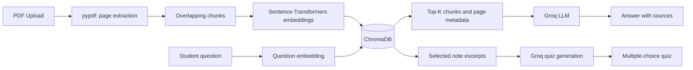

# Notely — Lecture Notes RAG Assistant 📚

A full-stack **Retrieval-Augmented Generation (RAG)** study assistant for your own PDF lecture notes. Upload PDFs, ask questions with **page-level source references**, and generate multiple-choice quizzes grounded in those notes.

**Stack:** React + Vite · FastAPI · Groq LLM · Sentence-Transformers · ChromaDB · pypdf · Docker

> The interface is in Turkish; this README is in English for GitHub audiences. The multilingual embedding model supports Turkish and English notes.

## Features

- **Upload PDFs:** Extract page-level text, split it into overlapping chunks, and persist it in ChromaDB.
- **Ask questions:** Embed the question, retrieve relevant chunks, and ask Groq to answer using only the retrieved context.
- **See citations:** Every retrieved excerpt shows its filename and original PDF page number. The answer refers to `[Kaynak 1]`, `[Kaynak 2]`, etc.
- **Create quizzes:** Generate five 4-option questions from the selected notes, then reveal the score and explanations.
- **Multi-document workflows:** Select several documents; remove documents and their indexed chunks.
- **Privacy-minded defaults:** No API key in browser; local persistent database; keys excluded from Git.
- **Docker Compose:** Frontend and backend in separate containers.

## Architecture



## Quickstart (Docker)

**Prerequisites:** Docker with Docker Compose, a [Groq API key](https://console.groq.com/keys).

```bash
git clone https://github.com/YOUR_USERNAME/lecture-notes-rag-assistant.git
cd lecture-notes-rag-assistant
cp .env.example .env
# Edit .env and set GROQ_API_KEY=...
docker compose up --build
```

Open **http://localhost:5173**. API reference: **http://localhost:8000/docs**.

> First upload downloads the multilingual embedding model and takes longer; it is cached on the Docker volume. Groq requires an internet connection. Model availability and token limits vary by Groq account.

## Local development (without Docker)

Requirements: Python 3.11+, Node.js 20+, a Groq API key.

```bash
cp .env.example .env
# Add GROQ_API_KEY=... to .env
cd backend
python -m venv .venv
source .venv/bin/activate           # Windows: .venv\Scripts\activate
pip install -r requirements.txt
uvicorn app.main:app --reload
```

In a second terminal:

```bash
cd frontend
npm install
npm run dev
```

Open **http://localhost:5173**. Vite proxies `/api/*` to FastAPI on port 8000.

## Usage

1. Upload one or more **text-based PDFs** from the sidebar.
2. Check the documents you want to use.
3. Ask a question and open its source excerpts to verify it.
4. Switch to **Quiz Oluştur** and create a five-question quiz.
5. Select answers and click **Sonuçları Gör** to see your score.

## API

| Method | Path | Description |
| --- | --- | --- |
| `GET` | `/health` | Health check |
| `GET` | `/documents` | List indexed PDFs |
| `POST` | `/documents` | Upload PDF (`multipart/form-data`, field `file`) |
| `DELETE` | `/documents/{document_id}` | Delete document and associated vectors |
| `POST` | `/ask` | Ask a grounded question |
| `POST` | `/quiz` | Generate 1–10 quiz questions |

Example:

```bash
curl -X POST http://localhost:8000/ask \
  -H 'Content-Type: application/json' \
  -d '{"question":"What is backpropagation?","document_ids":null}'
```

`document_ids: null` searches all documents. An empty array searches none. The response contains the answer and supporting excerpts with actual page metadata.

## Tests

```bash
cd backend
pip install -r requirements-dev.txt
pytest -q
```

Unit tests cover PDF text splitting and extraction; API tests use dependency stubs so they don't require a Groq key or downloading embedding models.

## Configuration

| Setting | Default | Description |
| --- | --- | --- |
| `GROQ_API_KEY` | empty | Required for Q&A and quizzes |
| `GROQ_MODEL` | `llama-3.3-70b-versatile` | Groq model identifier; change if unavailable |
| `EMBEDDING_MODEL` | `sentence-transformers/paraphrase-multilingual-MiniLM-L12-v2` | Local embedding model |
| `DATA_DIR` | `./data` | Local vector store and metadata |
| `MAX_UPLOAD_MB` | `20` | Maximum PDF size |
| `FRONTEND_ORIGIN` | `http://localhost:5173` | CORS origin for direct API requests |

## Project structure

```text
backend/
  app/              # API routes, RAG store, PDF parser, Groq client
  tests/            # API and parsing tests
frontend/
  src/              # React UI
  nginx.conf        # Docker reverse proxy to backend
.env.example        # Example secrets configuration
docker-compose.yml
README.md
```

## Limitations / roadmap

- **Text-based PDFs only:** Scanned/image-only PDFs need OCR (not included).
- **Citations are grounding aids, not formal verification:** Retrieved passages are authentic page-level excerpts, but generated statements can still be inaccurate.
- **Quiz questions can contain mistakes:** Always validate against the notes.
- **No accounts or authentication:** Intended for personal/local use. Do **not** deploy the API publicly as-is; add auth, rate limiting, and quotas first.
- **No per-user isolation:** All documents are shared by a single local database.
- Quiz samples from up to 16 distributed chunks; very long notes aren't fully represented in a single quiz request.

## License

MIT — see [LICENSE](LICENSE).
